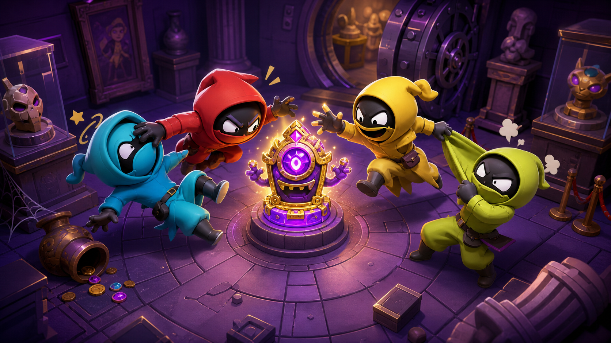
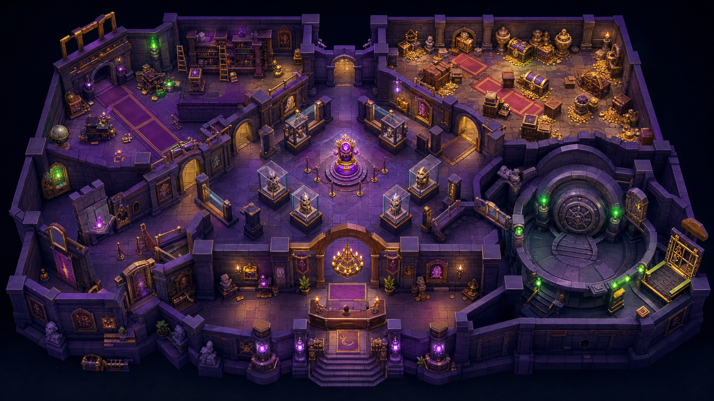
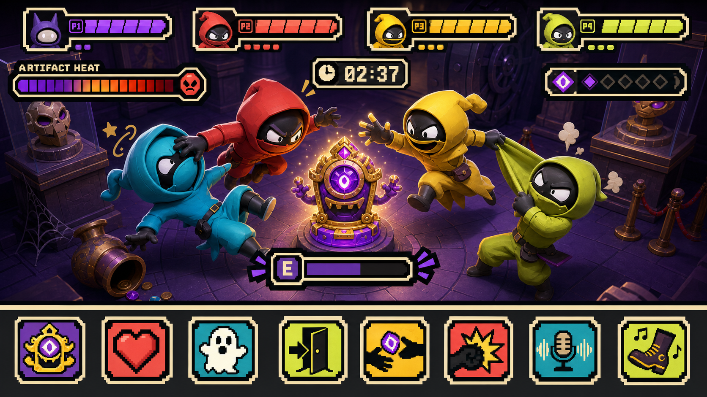

# Cursed Heist

Cursed Heist — прототип 3D-игры от первого лица про ограбление проклятого музея.

Игрок управляет одним из четырёх участников и должен завладеть проклятым артефактом, провести его через три печати и добраться до открывшегося выхода. Три остальных участника действуют как боты и пытаются помешать носителю артефакта.



## Что есть в прототипе

- раунд на 210 секунд в музейной арене, собранной из модульных ассетов;
- артефакт с перегревом и разрушаемой хваткой;
- три печати, которые нужно удерживать с артефактом для открытия выхода;
- сундуки, святилища Пустоты и мини-карта;
- три вида оружия: дубинка, мушкетон и пенный распылитель;
- четыре персонажа: Vix, Bulwark, Mirage и Bubbles;
- проклятия, оглушение, отбрасывание, прыжок и временное призрачное состояние;
- локализация на русском и английском языках;
- автоматические проверки игровых потоков, камеры от первого лица и бюджета сцены.

Это именно игровой прототип: сетевой режим, онлайн-сервис и полноценная система сборки релиза пока не входят в проект.

## Визуальные материалы

В репозитории также сохранены key art и визуальные референсы музея. Это концепт-материалы проекта, а не скриншоты запущенной игры.





## Технологии

- Godot 4.7.1;
- GDScript;
- 3D-рендерер Godot Compatibility / OpenGL;
- Blender Python для генерации части персонажей и музейных ассетов;
- локальные `.glb`, `.blend` и `.png`-ассеты проекта.

## Запуск

1. Установите Godot 4.7 или совместимую более новую версию.
2. Откройте `project.godot` в редакторе Godot.
3. Запустите главную сцену проекта.

Из командной строки:

```bash
godot --path .
```

Если исполняемый файл Godot называется иначе, замените `godot` на имя своей команды.

## Управление

Игрок 1:

| Действие | Клавиатура / мышь | Геймпад |
| --- | --- | --- |
| Движение | WASD | левый стик |
| Взаимодействие | E или правая кнопка мыши | A |
| Атака / толчок | Q или левая кнопка мыши | X |
| Эмоция | F | Y |
| Прыжок | Space | B |
| Камера | движение мыши | — |
| Освободить / захватить курсор | Esc | — |

После победы нажмите Enter, чтобы начать новый раунд.

## Проверки

Проверки запускаются из корня проекта в безоконном режиме, например:

```bash
godot --headless --path . --script res://tests/first_person_test.gd
godot --headless --path . --script res://tests/combat_flow_test.gd
godot --headless --path . --script res://tests/map_content_test.gd
godot --headless --path . --script res://tests/performance_budget_test.gd
godot --headless --path . --script res://tests/player_jump_test.gd
godot --headless --path . --script res://tests/seal_flow_test.gd
godot --headless --path . --script res://tests/weapon_system_test.gd
```

## Структура проекта

```text
assets/       модели, изображения и исходные Blender-файлы
core/         общие константы и правила симуляции
gameplay/     арена, персонажи, оружие, артефакт и игровые системы
localization/ переводы интерфейса
scenes/       главная сцена
tests/        безоконные игровые проверки
tools/blender скрипты генерации ассетов
ui/           HUD, мини-карта и карточки участников
```

`addons/funplay_mcp` — встроенный редакторский аддон с собственным MIT-лицензионным файлом. Он не является сетевым режимом игры.

## Лицензия

Для самого Cursed Heist лицензия пока не выбрана. Условия для встроенного аддона указаны отдельно в `addons/funplay_mcp/LICENSE`.
